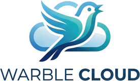
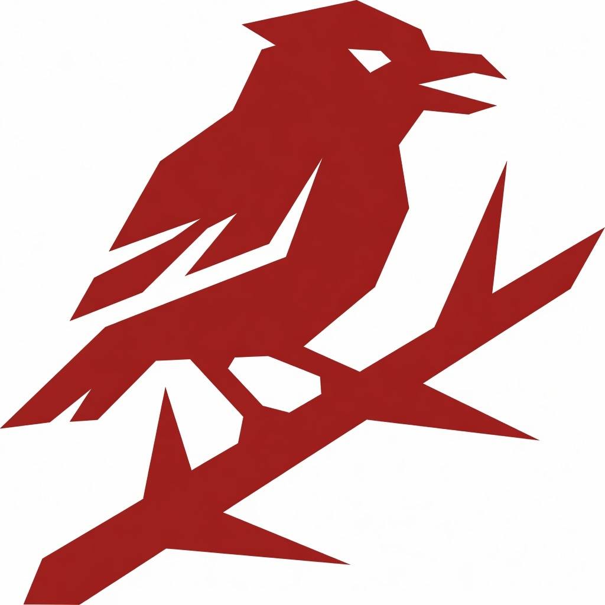
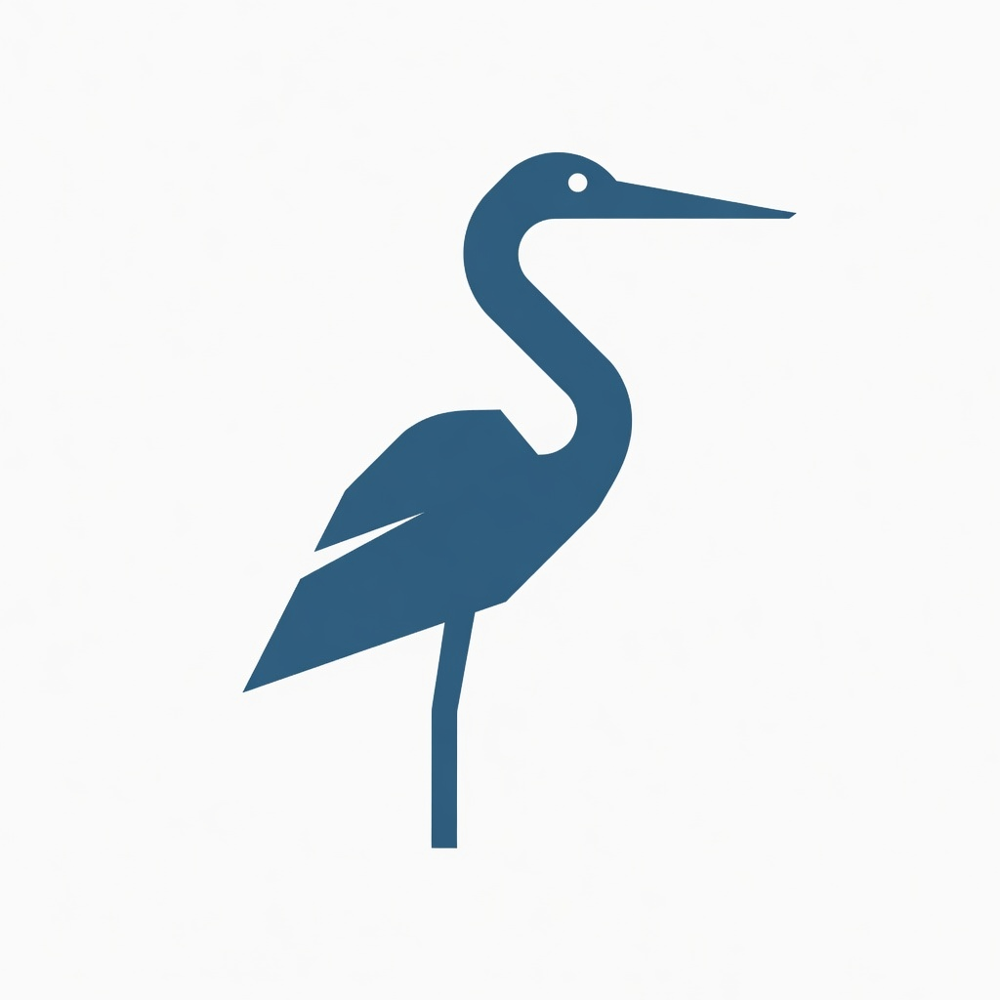
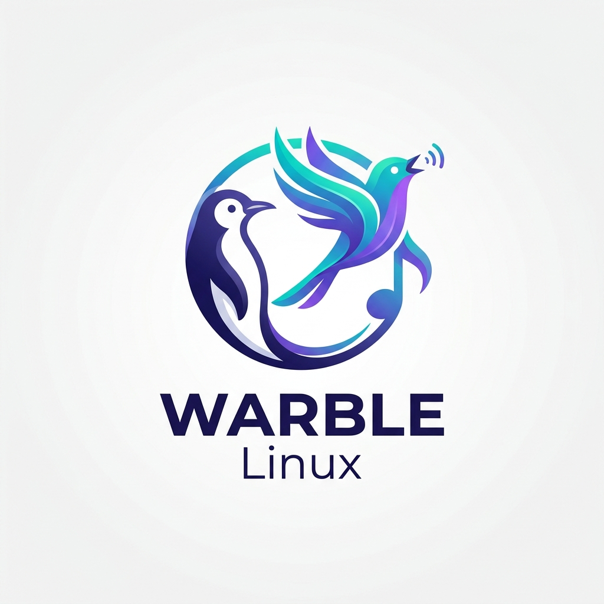
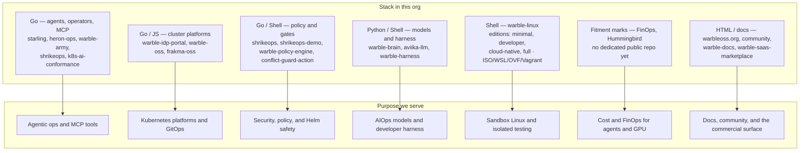
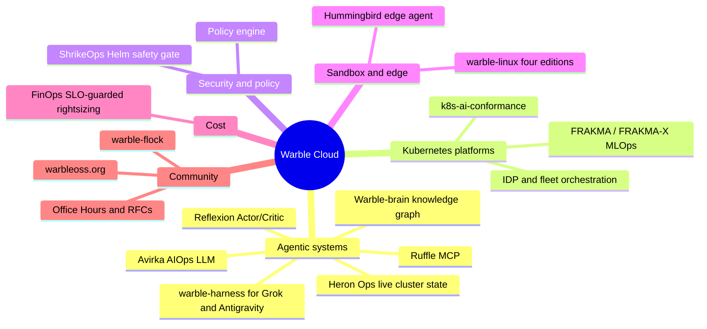

  

  
  
  
  

  
  &nbsp;&nbsp;
  
  &nbsp;&nbsp;
  
  &nbsp;&nbsp;
  
  &nbsp;&nbsp;
  
  &nbsp;&nbsp;
  
  &nbsp;&nbsp;
  
  &nbsp;&nbsp;
  

  
  &nbsp;&nbsp;&nbsp;
  

  <strong>Silver member</strong> of The Linux Foundation and the Agentic AI Foundation (AAIF). 
  Core Tech Member of the AAIF working groups: Taxonomy &amp; Landscape; Observability &amp; Tracing (Agent State, Context, and Reasoning); Identity &amp; Trust; Governance, Risk &amp; Regulatory; and Agentic Commerce. AAIF Tech Speaker.

# Warble Cloud

A premium cloud + AI platform by [ChirpStack LLP](https://chirpstackindia.com) (India) and WarbleCloud LLC (United States) — Ruffle MCP, Reflexion, FRAKMA, Avirka, and warble-flock. Birds of a feather.

We build agentic systems and Kubernetes-native tooling so teams can operate, secure, and reason about their estate: MCP servers for cluster ops, Actor/Critic remediation, policy and Helm safety gates, sandbox Linux images, and an AIOps model stack. Public work lives in this organization and at [warbleoss.org](https://warbleoss.org); the commercial platform is at [warblecloud.com](https://warblecloud.com).

## Projects

Open-source work in this organization. Flock logos and one-line copy for ShrikeOps and Heron Ops follow [warbleoss.org](https://warbleoss.org) and the logo table in [warble-army `brand/README.md`](https://github.com/warbletech/warble-army/blob/main/brand/README.md). Other rows use each repository's description. All marks are shown at 48px.

The public umbrella repository is still named [`warbletech/warble-army`](https://github.com/warbletech/warble-army) while the product name **warble-flock** (formerly Warble Army) rolls out. **Ruffle MCP** (formerly Starling MCP) is the user-facing name of the Kubernetes MCP server; the public repositories are still [`starling`](https://github.com/warbletech/starling) and [`starling-community`](https://github.com/warbletech/starling-community).

<table>
  <thead>
    <tr>
      <th></th>
      <th>Project</th>
      <th>Description</th>
    </tr>
  </thead>
  <tbody>
  <tr>
    <td align="center"></td>
    <td><a href="https://warbleoss.org/#flock"><strong>ShrikeOps</strong></a> <a href="https://github.com/warbletech/shrikeops">warbletech/shrikeops</a> · <a href="https://github.com/warbletech/shrikeops-demo">shrikeops-demo</a></td>
    <td>Hunts misconfigurations, CVEs, and deprecated APIs. Impales findings on a scored report before they hit production.</td>
  </tr>
  <tr>
    <td align="center"></td>
    <td><a href="https://warbleoss.org/#flock"><strong>Heron Ops</strong></a> <a href="https://github.com/warbletech/heron-ops">warbletech/heron-ops</a></td>
    <td>Kubernetes MCP server for live pods, logs, events, and metrics. Formerly SteadyHelm. Calm observation, precise tools for any agent IDE.</td>
  </tr>
  <tr>
    <td align="center"></td>
    <td><a href="https://github.com/warbletech/starling"><strong>Ruffle MCP</strong></a> <a href="https://github.com/warbletech/starling-community">starling-community</a></td>
    <td>MCP server for Kubernetes ops (formerly Starling MCP). Scan manifests, read live clusters, remediate. The community plugin is a read-only MCP surface for Grok and Antigravity. No unique official mark has been published yet, so the Warble icon stands in.</td>
  </tr>
  <tr>
    <td align="center"></td>
    <td><a href="https://github.com/warbletech/warble-army"><strong>warble-flock</strong></a></td>
    <td>Kubernetes agents + MCP umbrella (ShrikeOps, Heron Ops, Ruffle MCP). Formerly Warble Army. The GitHub repository name has not changed yet.</td>
  </tr>
  <tr>
    <td align="center"></td>
    <td><a href="https://github.com/warbletech/warble-linux"><strong>warble-linux</strong></a></td>
    <td>Sandbox-oriented Linux live images for isolated testing, learning, and cloud-native workflows. Four editions · ISO · WSL · OVF · Vagrant. GPL-2.0.</td>
  </tr>
  <tr>
    <td align="center"></td>
    <td><a href="https://warbleoss.org/"><strong>warbleoss.org</strong></a> <a href="https://github.com/warbletech/warbleoss.org">warbletech/warbleoss.org</a></td>
    <td>Open-source home for warble-flock (ShrikeOps, Heron Ops, and the community self-host chart).</td>
  </tr>
  <tr>
    <td align="center"></td>
    <td><a href="https://warbleoss.org/#community"><strong>community</strong></a> <a href="https://github.com/warbletech/community">warbletech/community</a></td>
    <td>Warble Cloud community — Office Hours, working groups, RFCs, governance.</td>
  </tr>
  <tr>
    <td align="center"></td>
    <td><a href="https://warbleoss.org/#start"><strong>warble-bootstrap</strong></a> <a href="https://github.com/warbletech/warble-bootstrap">warbletech/warble-bootstrap</a></td>
    <td>Org clone script and the map of where Warble deploys. Listed on warbleoss.org as a local-stack starting point.</td>
  </tr>
  <tr>
    <td align="center"></td>
    <td><a href="https://github.com/warbletech/k8s-ai-conformance"><strong>k8s-ai-conformance</strong></a></td>
    <td>Kubernetes AI Conformance.</td>
  </tr>
  </tbody>
</table>

Related public utility: [ui-intern-assignment](https://github.com/warbletech/ui-intern-assignment) (UI intern take-home).

## Platform

Product marks below are the ones shown on the [fitment guide](https://warblecloud.com/fitment). Where a public repository exists, it is linked; otherwise the link goes to the website. No usage or customer metrics are claimed here.

<table>
  <thead>
    <tr>
      <th></th>
      <th>Product</th>
      <th>Purpose we serve</th>
    </tr>
  </thead>
  <tbody>
  <tr>
    <td align="center"></td>
    <td><a href="https://warblecloud.com/products"><strong>Reflexion</strong></a></td>
    <td>Actor/Critic incident remediation (Dual-Brain Agentic Ops).</td>
  </tr>
  <tr>
    <td align="center"></td>
    <td><a href="https://warblecloud.com/products"><strong>Warble-brain</strong></a> / <strong>Avirka</strong></td>
    <td>Knowledge graph of your estate; internal AIOps LLM (Avirka-EN) for the FRAKMA / Reflexion stack. No unique official Avirka mark has been published yet, so the Warble-brain mark is used here.</td>
  </tr>
  <tr>
    <td align="center"></td>
    <td><a href="https://warblecloud.com/products"><strong>FRAKMA / FRAKMA-X</strong></a></td>
    <td>GitOps-native MLOps on Kubernetes (FRAKMA family; Avirka is the open SRE LLM line).</td>
  </tr>
  <tr>
    <td align="center"></td>
    <td><a href="https://warblecloud.com/fitment"><strong>Hummingbird</strong></a></td>
    <td>Lightweight edge / on-device agent (fitment copy). There is no public repository under this name yet.</td>
  </tr>
  <tr>
    <td align="center"></td>
    <td><a href="https://warblecloud.com/fitment"><strong>FinOps</strong></a></td>
    <td>SLO-guarded cost rightsizing, including GPU / neocloud (fitment copy). Listed on fitment as a separate mark from Hummingbird.</td>
  </tr>
  <tr>
    <td align="center"></td>
    <td><a href="https://warblecloud.com/fitment"><strong>Sovereign Agent</strong></a></td>
    <td>In-VPC reproducible ML pipelines.</td>
  </tr>
  </tbody>
</table>

Murmuration is architectural advisory (an engagement model on the fitment questionnaire), not a public code repository in this organization.

## Stack → purpose

A knowledge tree of the stack we actually maintain in this organization, mapped to the purpose each layer serves. Languages are the GitHub primary language of the listed repositories. Private platform repos are named only as evidence of the stack; they are not all public. Repository directory names below are unchanged even where product names have moved on.

## Coming soon

These items are underway in public repos or issues. They are **not generally available yet**, and no delivery dates are implied.

- **Reusable GitHub agentic workflows.** This repository adopts the [Central Agentic Ops Documentation Pages pattern](https://githubnext.github.io/gh-cao/deployment-actions/#building-the-synthetic-pages-demo): a GitHub Pages site that publishes documentation plus a clearly labeled **synthetic** enterprise demo, with no operational evidence and no live services. Broader use of [githubnext/agentics](https://github.com/githubnext/agentics) / `gh-aw` across the org is still ahead. Preview, once Pages is enabled: `https://warbletech.github.io/.github/`.
- **warble-flock rename.** The product formerly called Warble Army is now **warble-flock**. Rollout of the new name in nav and marketing copy is tracked in [warble-core#272](https://github.com/warbletech/warble-core/issues/272). The public umbrella repo is still [`warbletech/warble-army`](https://github.com/warbletech/warble-army).
- **Ruffle MCP community project.** User-facing copy was updated to **Ruffle MCP** (formerly Starling MCP) in [warble-core#262](https://github.com/warbletech/warble-core/pull/262). The public repositories and the community plugin are still named `starling` and `starling-community`.
- **CNCF Sandbox application.** A Sandbox application draft for the open flock is kept at [`docs/cncf/SANDBOX_APPLICATION.md`](https://github.com/warbletech/warble-army/blob/main/docs/cncf/SANDBOX_APPLICATION.md). [warbleoss.org/CNCF.md](https://github.com/warbletech/warbleoss.org/blob/main/CNCF.md) tracks readiness; the project is **not** a CNCF project until the TOC accepts an application filed on [`cncf/sandbox`](https://github.com/cncf/sandbox).
- **FRAKMA-X Linux Foundation wing.** [warbleoss.org](https://warbleoss.org) describes the Frakma-X LF wing as forming, separate from the commercial FRAKMA surface at [frakma.io](https://frakma.io).

## Community

- Website: [warblecloud.com](https://warblecloud.com) · Fitment: [warblecloud.com/fitment](https://warblecloud.com/fitment)
- Open source home: [warbleoss.org](https://warbleoss.org)
- Docs: [docs.warblecloud.com](https://docs.warblecloud.com)
- Community repo: [warbletech/community](https://github.com/warbletech/community)
- X: [@warblecloud](https://x.com/warblecloud) · YouTube: [@warble-tech](https://www.youtube.com/@warble-tech)
- Contact: [contact@warblecloud.com](mailto:contact@warblecloud.com)

Warble Cloud is a Silver member of The Linux Foundation and the Agentic AI Foundation. Core Tech Member of the AAIF working groups: Taxonomy & Landscape; Observability & Tracing (Agent State, Context, and Reasoning); Identity & Trust; Governance, Risk & Regulatory; and Agentic Commerce. AAIF Tech Speaker.
