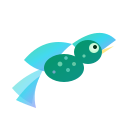
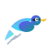
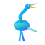
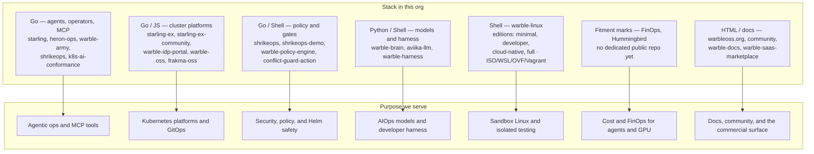
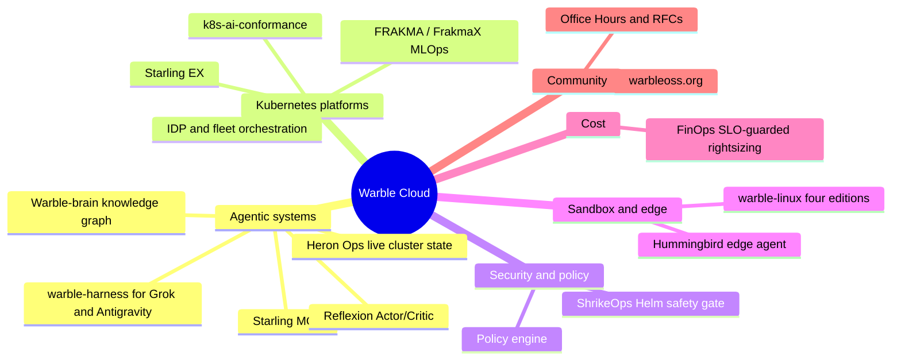

  

  
  
  
  

# Warble Cloud

A premium cloud + AI platform by [ChirpStack LLP](https://chirpstackindia.com) (India) and WarbleCloud LLC (United States) — Starling, Reflexion, Murmuration, and Brain. Birds of a feather.

We build agentic systems and Kubernetes-native tooling so teams can operate, secure, and reason about their estate: MCP servers for cluster ops, Actor/Critic remediation, policy and Helm safety gates, sandbox Linux images, and an AIOps model stack. Public work lives in this organization; the commercial platform is at [warblecloud.com](https://warblecloud.com).

## Projects

Open-source repositories in this organization. Descriptions are taken from the repositories themselves.

<table>
  <thead>
    <tr>
      <th></th>
      <th>Project</th>
      <th>Description</th>
    </tr>
  </thead>
  <tbody>
  <tr>
    <td align="center"></td>
    <td><a href="https://github.com/warbletech/starling"><strong>Starling</strong></a> <a href="https://github.com/warbletech/starling-community">starling-community</a></td>
    <td>MCP server for Kubernetes ops. Scan manifests, read live clusters, remediate. Community plugin is a read-only MCP surface for Grok and Antigravity.</td>
  </tr>
  <tr>
    <td align="center"></td>
    <td><a href="https://github.com/warbletech/shrikeops"><strong>ShrikeOps</strong></a> <a href="https://github.com/warbletech/shrikeops-demo">shrikeops-demo</a></td>
    <td>Kubernetes Helm safety gate — Pluto + Polaris + kube-score + OPA + OSV vulndb. Demo scans manifests, charts, and live GKE/EKS clusters.</td>
  </tr>
  <tr>
    <td align="center"></td>
    <td><a href="https://github.com/warbletech/heron-ops"><strong>Heron Ops</strong></a></td>
    <td>Kubernetes MCP server for AI agents (live cluster state). Part of Warble Army / warbleoss.org.</td>
  </tr>
  <tr>
    <td align="center"></td>
    <td><a href="https://github.com/warbletech/warble-army"><strong>Warble Army</strong></a></td>
    <td>Kubernetes agents + MCP umbrella (ShrikeOps, SteadyHelm, Starling Lite).</td>
  </tr>
  <tr>
    <td align="center"></td>
    <td><a href="https://github.com/warbletech/warble-linux"><strong>warble-linux</strong></a></td>
    <td>Sandbox-oriented Linux live images for isolated testing, learning, and cloud-native workflows. Four editions · ISO · WSL · OVF · Vagrant. GPL-2.0.</td>
  </tr>
  <tr>
    <td align="center"></td>
    <td><a href="https://github.com/warbletech/warbleoss.org"><strong>warbleoss.org</strong></a></td>
    <td>Open-source home for Warble Army (ShrikeOps, Heron Ops, Starling EX CE).</td>
  </tr>
  <tr>
    <td align="center"></td>
    <td><a href="https://github.com/warbletech/k8s-ai-conformance"><strong>k8s-ai-conformance</strong></a></td>
    <td>Kubernetes AI Conformance.</td>
  </tr>
  <tr>
    <td align="center"></td>
    <td><a href="https://github.com/warbletech/community"><strong>community</strong></a></td>
    <td>Warble Cloud community — Office Hours, working groups, RFCs, governance.</td>
  </tr>
  </tbody>
</table>

Related public utilities: [warble-bootstrap](https://github.com/warbletech/warble-bootstrap) (org clone script and deployment map), [ui-intern-assignment](https://github.com/warbletech/ui-intern-assignment) (UI intern take-home).

## Platform

Product marks below are the ones shown on the [fitment guide](https://warblecloud.com/fitment). Where a public repository exists, it is linked; otherwise the link goes to the website. No usage or customer metrics are claimed here.

<table>
  <thead>
    <tr>
      <th></th>
      <th>Product</th>
      <th>Purpose we serve</th>
    </tr>
  </thead>
  <tbody>
  <tr>
    <td align="center"></td>
    <td><a href="https://warblecloud.com/products"><strong>Reflexion</strong></a></td>
    <td>Actor/Critic incident remediation (Dual-Brain Agentic Ops).</td>
  </tr>
  <tr>
    <td align="center"></td>
    <td><a href="https://warblecloud.com/products"><strong>Warble-brain</strong></a></td>
    <td>Knowledge graph of your estate; internal AIOps LLM (Avirka-EN) for the FRAKMA / Reflexion stack.</td>
  </tr>
  <tr>
    <td align="center"></td>
    <td><a href="https://warblecloud.com/products"><strong>FrakmaX</strong></a></td>
    <td>GitOps-native MLOps on Kubernetes (FRAKMA family; Avirka is the open SRE LLM line).</td>
  </tr>
  <tr>
    <td align="center"></td>
    <td><a href="https://warblecloud.com/fitment"><strong>Hummingbird</strong></a></td>
    <td>Lightweight edge / on-device agent (fitment copy). There is no public repository under this name yet.</td>
  </tr>
  <tr>
    <td align="center"></td>
    <td><a href="https://warblecloud.com/fitment"><strong>FinOps</strong></a></td>
    <td>SLO-guarded cost rightsizing, including GPU / neocloud (fitment copy). Listed on fitment as a separate mark from Hummingbird.</td>
  </tr>
  <tr>
    <td align="center"></td>
    <td><a href="https://warblecloud.com/fitment"><strong>Sovereign Agent</strong></a></td>
    <td>In-VPC reproducible ML pipelines.</td>
  </tr>
  <tr>
    <td align="center"></td>
    <td><strong>Starling EX</strong></td>
    <td>One-command DevOps platform for Kubernetes (Dex SSO + CRD-managed components). Community Edition is positioned as a CNCF Sandbox candidate; the public umbrella is <a href="https://github.com/warbletech/warble-army">Warble Army</a>.</td>
  </tr>
  </tbody>
</table>

Murmuration is architectural advisory (an engagement model on the fitment questionnaire), not a public code repository in this organization.

## Stack → purpose

A knowledge tree of the stack we actually maintain in this organization, mapped to the purpose each layer serves. Languages are the GitHub primary language of the listed repositories. Private platform repos are named only as evidence of the stack; they are not all public.

## Community

- Website: [warblecloud.com](https://warblecloud.com) · Fitment: [warblecloud.com/fitment](https://warblecloud.com/fitment)
- Open source home: [warbleoss.org](https://warbleoss.org)
- Docs: [docs.warblecloud.com](https://docs.warblecloud.com)
- Community repo: [warbletech/community](https://github.com/warbletech/community)
- X: [@warblecloud](https://x.com/warblecloud) · YouTube: [@warble-tech](https://www.youtube.com/@warble-tech)
- Contact: [contact@warblecloud.com](mailto:contact@warblecloud.com)
